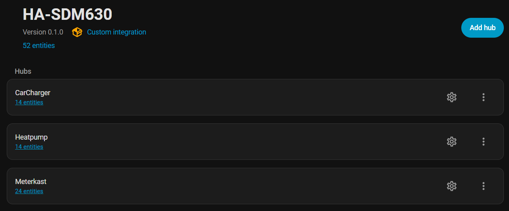
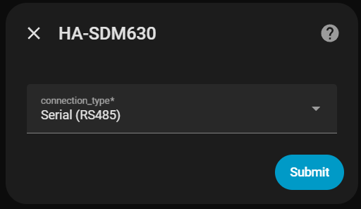
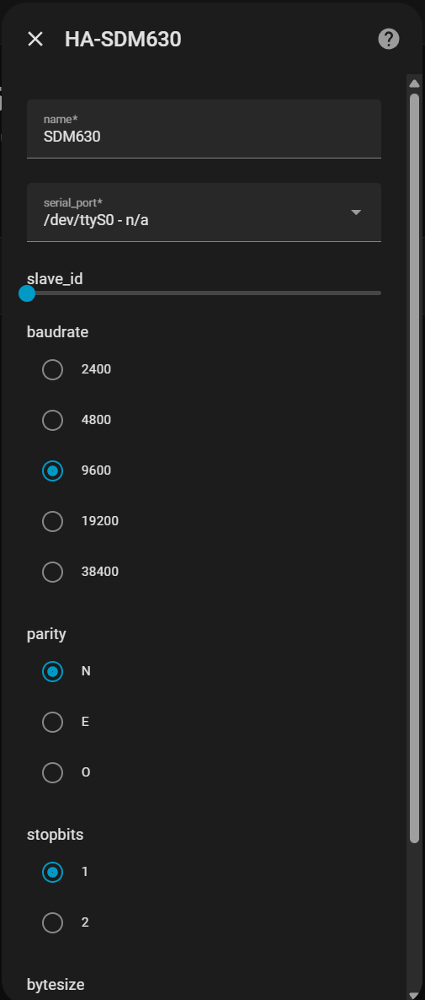

# HA-SDM630 (Modbus)
[](https://www.home-assistant.io)
[](https://hacs.xyz)
[](https://github.com/partach/ha_sdm630/actions)
[](https://github.com/partach/ha_sdm630/releases)
[](https://github.com/partach/ha_sdm630/blob/main/LICENSE)
[](https://github.com/hacs/integration)

**UPDATE: I created the [protocol wizard](https://github.com/partach/protocol_wizard). It supports any Modbus device, also the SDM630**<br>

SDM630 home assistant integration for easy setup and use of the device (via Modbus)


<p align="center">
  
  <br>
  <em>Integration after installation</em>
</p>
<p align="center">
  
  <br>
  <em>The product that will be monitored via modbus</em>
</p>

## Features
- No need for any yaml configuration!
- Serial and TCP Modbus support
- USB/Serial port selection via dropdown
- Customizable communication settings
- Customizable registers (basic, basic plus, full). No need to clutter your entities with unwanted registers
- Hassle free use of the device
- Multiple hubs supported, ability to add many of the devices, all with different settings.
- Very easy and straight forward!

## Installation
Options:
1. Install via HACS (is coming in the near future)
2. Install manually:
   * The integration: In UI go to `HACS`--> `custom repositories` --> `Repo`: partach/ha_sdm630, `Type`: Integration
   * After HA reboot (Needed for new integrations): choose 'add integration' (in devices and services) and choose `HA-SMD630` in the list.
     
Let the install config of the integration guide you as it asks you for the needed data.

## Configuration options
<p align="center">
  
  <br>
  <em>Select Serial or TCP</em>
</p>
<p align="center">
  
  <br>
  <em>Serial Example, choose the settings you need</em>
</p>

### Options (after setup)
Open the integration and click **Configure** to change:
- **Register set**: basic, basic plus or full.
- **Update interval**: polling time in seconds (5 to 300).
- **Registers per read request** (default 40): values that sit close together are fetched in one request, so a poll needs 3 requests (Basic) to 7 (Full) instead of 10 to 46. If your gateway has trouble with long reads, lower it; 4 gives the behaviour of version 0.3.4 and earlier. If the meter refuses a long read, the integration falls back to reading those values one by one automatically.
- **Invert power sign**: use this if the meter shows negative power while it is drawing power (in/out wires or clamps swapped). Phase and total power are multiplied by -1.
- **Swap import and export counters**: for the same wiring problem, report the meter's export counters as import and the other way round.

Changing the swap option makes the import and export sensors jump to each other's values. Home Assistant records that jump in its long-term statistics, so if one of those sensors is already in the Energy dashboard, fix the spike in **Developer Tools > Statistics** or keep using the counter you already had and turn only *Invert power sign* on.

### Changing the connection
To move a meter to another USB port, IP address or Modbus address, open the integration, click the three dots and choose **Reconfigure**. The new settings are tested before they are saved, and the sensors and their history stay as they are.

### TCP: Modbus TCP or RTU over TCP
A real Modbus TCP gateway uses *Modbus TCP*. Many cheap RS485-to-Ethernet converters (in "transparent" mode) just pass the RS485 traffic through; choose *RTU over TCP* for those.

### When the meter can't be reached
- **At startup** (bus not powered, USB adapter missing, gateway down): the integration still loads, its sensors show *unavailable*, and it tries to connect again every 5 minutes.
- **While running**: it retries after 30 s, 1 min, 2 min and then every 5 min until the meter answers again. You get one error in the log when the connection drops and one message when it is back, not a line for every attempt.

### Debug logging
The integration keeps the pymodbus library quiet unless you set its log level yourself, for example:
```yaml
logger:
  logs:
    custom_components.ha_sdm630: debug
    pymodbus: warning
```

## Development
Tests run against a simulated meter:
```bash
pip install -r requirements_test.txt
pytest
```

## Discussion 
See [here](https://github.com/partach/ha_sdm630/discussions)

## Changelog
See [CHANGELOG.md](https://github.com/partach/ha_sdm630/blob/main/CHANGELOG.md)

## Issues
Report at GitHub [Issues](https://github.com/partach/ha_sdm630/issues)

## Support development
If you like it and find it usefull or want to support this and future developments it would be greatly appreciated :)

[](https://paypal.me/therealbean)
